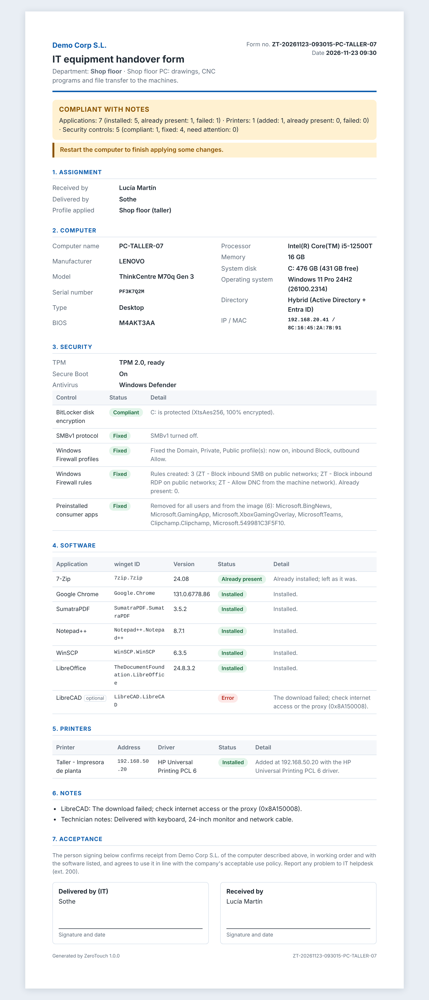

# ZeroTouch Windows Provisioning

[](https://github.com/ImSothe/ZeroTouch-Windows-Provisioning/actions/workflows/ci.yml)


Sets up a new Windows PC for its department in one command. It reads the department's profile (a
JSON file such as `oficina.json` or `taller.json`), **installs the department's applications
silently with winget**, adds its **network printers**, applies a **security baseline** (BitLocker, SMBv1, Windows Firewall,
preinstalled consumer apps) and writes a **handover form** ("acta de entrega") with the computer's
details, ready to print and sign.

It runs from a USB stick with a technician in front of the PC, or as an **Intune Win32 app** with
Autopilot, where nobody touches the PC at all. That is the step between traditional desktop support
and Modern Workplace: the same result on every computer, written down, without depending on who
prepared it.

> **Built with AI assistance (Claude Code).** The scope comes from day-to-day IT support: what a
> technician repeats by hand every time a new PC arrives. Every step reads the current state first and
> changes only what differs from the profile, and `-WhatIf` shows every change before it is made.

**Try it without changing anything:** run `.\Invoke-ZeroTouch.ps1 -Department oficina -WhatIf` on any
Windows PC, or open the sample forms: [English](docs/sample-handover.html) ·
[Spanish](docs/sample-handover.es.html) (download and open them in a browser).



<sub>Sample handover form (English). The same run in Spanish: [docs/img/handover-es.png](docs/img/handover-es.png).</sub>

## Why it exists

Preparing a PC by hand takes hours and the result depends on who does it:

- installing the same ten programs one installer at a time, clicking *Next* on each
- forgetting one (the PDF printer, the VPN client) and getting a ticket on the user's first day
- SMBv1 still on, the firewall with default settings, Candy Crush and Xbox apps on an office PC
- BitLocker "turned on later", or turned on with the recovery key saved nowhere
- no record of what was delivered: serial number, who received it, in what state

So the goals were:

- **One command per PC, one JSON file per department.** The department decides the software; the
  technician only picks the department.
- **Safe to run twice.** Already installed apps and settings that are already correct are left alone.
- **Never make things worse.** No encryption without a stored recovery key, no removal of system
  packages winget or Intune depend on, `-WhatIf` everywhere.
- **A paper trail.** A form the user signs, and its JSON twin for the inventory.

## What it does

| Step | Detail |
|---|---|
| **1. Profile** | Loads `profiles\<department>.json` and everything it inherits (`taller` → `base`), then validates it. A typo fails here, before anything changes. |
| **2. Applications** | For each app: `winget list` to see if it is there, else `winget install --exact --silent` with the agreements accepted. Retries transient errors (app in use, another install running, network), explains the rest, detects "restart required". Works as SYSTEM, where winget is not on the PATH. |
| **3. Printers** | Adds the department's network printers for the whole machine: driver (staging the vendor's `.inf` with `pnputil` if needed), TCP/IP port and queue. Existing printers are left alone. |
| **4. Security baseline** | BitLocker, SMBv1, firewall profiles and rules, preinstalled apps. See [Security baseline](#security-baseline). |
| **5. Inventory** | Make, model, serial number, CPU, RAM, disk, Windows version and build, IP/MAC, Entra ID / AD join, TPM, Secure Boot, antivirus. |
| **6. Handover form** | `Reports\<form id>.html` (print and sign), `.json` (for GLPI or any inventory), optional `.pdf` (Edge, headless). English or Spanish. |
| **7. Marker** | `HKLM:\SOFTWARE\ZeroTouch` with profile, result and form path: the Intune detection rule. |

Exit codes: `0` success · `3010` success, restart needed · `1` failed (a required app or a control failed).
A printer that cannot be added is a note on the form, not a failure: retrying would not fix a missing driver.

## Quick start

```powershell
# Technician at the PC: double-click Start-ZeroTouch.cmd (asks for admin rights), or:
.\Invoke-ZeroTouch.ps1                      # department menu, asks who receives the PC

# Simulation: checks everything, changes nothing, writes a form marked SIMULATION
.\Invoke-ZeroTouch.ps1 -Department taller -WhatIf

# A sales laptop for Lucia, with the form also as PDF
.\Invoke-ZeroTouch.ps1 -Department comercial -AssignedUser 'Lucia Martin' -Pdf

# Intune Win32 app install command (runs as SYSTEM, see docs/intune.md)
powershell.exe -ExecutionPolicy Bypass -File .\Invoke-ZeroTouch.ps1 -Department comercial

# Which departments exist
.\Invoke-ZeroTouch.ps1 -ListDepartments
```

| Parameter | Meaning |
|---|---|
| `-Department` | Profile name (`oficina`, `taller`...) or path to a profile file. Without it, a menu. |
| `-AssignedUser` | Who receives the PC. Empty: a blank line to write by hand on the printed form. |
| `-Technician` | Who prepares it. Default: the current user. |
| `-OutputPath` | Logs and forms. Default `C:\ProgramData\ZeroTouch`; a share collects every form in one place. |
| `-Language` | `en` or `es`. Default: the profile's `organization.language`. |
| `-Notes` | Free text for the form: accessories delivered, scratches, pending items. |
| `-SkipApplications`, `-SkipPrinters`, `-SkipSecurity` | Run only part of the provisioning. |
| `-Pdf` | Also save the form as PDF (Microsoft Edge, headless). |
| `-WhatIf` | Simulation. Nothing is installed, changed or removed; no registry marker. |

Full help: `Get-Help .\Invoke-ZeroTouch.ps1 -Full`.

Downloaded the ZIP from GitHub? Windows marks the files as coming from the internet. Run
`Get-ChildItem -Recurse | Unblock-File` in the folder once, or start it with `Start-ZeroTouch.cmd`,
which uses `-ExecutionPolicy Bypass` for that one process.

## Department profiles

One JSON file per department in `profiles\`. The repository ships the profiles of a fictional Spanish
company, *Demo Corp S.L.*, which is why they have Spanish names and the form defaults to Spanish:

| Profile | For | Inherits | Adds |
|---|---|---|---|
| [`base`](profiles/base.json) | Every PC (hidden from the menu) | | 7-Zip, Chrome, Acrobat Reader; the whole security baseline; company name and form language |
| [`oficina`](profiles/oficina.json) | Office staff | `base` | Microsoft 365 Apps, Teams, PDF24 and Greenshot (optional); the first-floor multifunction printer |
| [`taller`](profiles/taller.json) | Shop floor | `base` | SumatraPDF instead of Acrobat, Notepad++ for CNC programs, WinSCP to send files to the machines, LibreOffice, LibreCAD; the shop floor printer, with its driver staged from a share; a firewall rule that only accepts DNC traffic from the machine network |
| [`comercial`](profiles/comercial.json) | Sales laptops | `oficina` | Zoom; **BitLocker enforced**; SMB blocked on home networks too (the office printer comes from `oficina`) |

```json
{
  "$schema": "./schema/profile.schema.json",
  "name": "comercial",
  "displayName": "Comercial (portátil)",
  "extends": "oficina",
  "applications": [ { "id": "Zoom.Zoom", "name": "Zoom", "required": false } ],
  "security": { "bitlocker": { "action": "Enable" } }
}
```

Child values win, lists add up (apps by `id`, firewall rules by `displayName`), and
`removeApplications` drops inherited apps. VS Code autocompletes and validates the files through
[`profiles/schema/profile.schema.json`](profiles/schema/profile.schema.json); ZeroTouch validates them
again on load, rejecting invalid winget ids, ports, actions, and any pattern that could remove a
protected system package.

### Getting the profile for each department

You do not have to write the JSON by hand. [`New-DepartmentProfile.ps1`](New-DepartmentProfile.ps1)
builds it four ways:

```powershell
# A. On a reference PC already set up the way the department works: its apps and its network printers
.\New-DepartmentProfile.ps1 -FromThisComputer -Name taller -DisplayName 'Taller'

# B. From 'winget export -o taller.json' taken on that PC by anyone
.\New-DepartmentProfile.ps1 -ExportFile .\taller.json -Name taller

# C. One profile per department from an Excel list (Departamento;Id;Nombre;Obligatoria)
.\New-DepartmentProfile.ps1 -CsvPath .\examples\departments.csv

# D. From winget ids you already know
.\New-DepartmentProfile.ps1 -PackageId Zoom.Zoom, SumatraPDF.SumatraPDF -Name formacion
```

It leaves out what the parent profile already installs, runtimes, built-in apps and hardware vendor
tools, and never overwrites an existing file without `-Force`. The full guide, including what to do
with software that is not in winget: **[docs/department-profiles.md](docs/department-profiles.md)**.

### Network printers

A department's printers belong in its profile, like its applications:

```json
"printers": [
  { "name": "Taller - Impresora de planta", "address": "192.168.50.20", "driver": "HP Universal Printing PCL 6",
    "driverInf": "\\\\srv-files\\drivers\\hp-upd-pcl6\\hpcu270u.inf", "location": "Nave 2" }
]
```

ZeroTouch adds the driver (from the driver store, or staging `driverInf` with `pnputil` first), a
Standard TCP/IP port and the queue, for every user of the PC. Capturing a reference PC with
`-FromThisComputer` takes its printers too, but **only the ones worth copying**:

| On the reference PC | Copied? | Why |
|---|---|---|
| Network printer on a TCP/IP port | **Yes** | Machine-wide, works when ZeroTouch runs as SYSTEM (Intune), and it is the department's printer, not one person's. |
| Print server queue (`\\server\printer`) | No | It is a per-user connection: as SYSTEM it would land in SYSTEM's profile. Deploy it with Group Policy, Universal Print or Intune. |
| USB printer, WSD printer | No | It belongs to one desk, and WSD ports have no fixed address. Add it by IP instead. |
| PDF, XPS, OneNote, Fax | No | Built into Windows. |
| User files, browser and app settings | No | Not a department setting. That is OneDrive Known Folder Move or a migration tool such as USMT. |

## Security baseline

| Control | What ZeroTouch does | Why |
|---|---|---|
| **BitLocker** | `Report` (default): checks the system drive and reports it. `Enable`: only with a ready TPM; adds a recovery password, **escrows it to Entra ID or Active Directory first**, then encrypts (XTS-AES 256, used space) or resumes suspended protection. If the key cannot be stored anywhere, it does **not** encrypt. | A lost laptop is a data breach unless the disk is encrypted. An encrypted disk whose key is stored nowhere is lost data the first time the TPM asks for recovery. |
| **SMBv1** | Turns off the SMB 1.0 server setting and removes the optional feature (restart flagged, never forced). | SMBv1 is what WannaCry and NotPetya spread through (EternalBlue). Nothing in a modern office needs it. |
| **Firewall** | All three profiles on, inbound blocked and outbound allowed by default, dropped packets logged. Creates the profile's rules, in the `ZeroTouch` group, if missing. | A laptop on hotel Wi-Fi must not answer SMB or RDP. Department rules (like the workshop's DNC port) open only what is needed, from where it is needed. |
| **Preinstalled apps** | Removes the listed Appx packages for every user and from the provisioned image, so new users do not get them back. **Never** removes winget, the Store, Windows Security, the Entra ID sign-in broker, Company Portal, the shell or the runtimes, even if a pattern matches them. | Less attack surface, fewer distractions and support tickets, and a cleaner Start menu on a work PC. |

Every control reads the state first and changes only what differs, so a second run reports
*Compliant* and changes nothing. Setting a control to `false` in a profile skips it (`"bitlocker": false`).

## The handover form

One self-contained HTML page (no scripts, no external files, a strict Content Security Policy) that
prints on A4:

1. **Assignment:** who receives the PC, who delivers it, which profile was applied.
2. **Computer:** name, make, model (Lenovo's friendly name, not the machine type), serial number,
   type (laptop/desktop/VM), BIOS, CPU, RAM, disk, Windows release and build, Entra ID/AD join, IP/MAC.
3. **Security:** TPM, Secure Boot, antivirus, and the result of every baseline control.
4. **Software:** each app with its winget id, installed version and result; optional apps tagged.
5. **Printers:** each network printer with its address, driver and result.
6. **Notes:** what failed or needs attention, plus the technician's notes.
7. **Acceptance:** terms of use and signature boxes for both sides.

The overall result is shown at the top: *compliant*, *compliant with notes*, *not compliant* or
*simulation*, plus a restart notice when needed. The JSON twin has the same data plus message keys,
so the form can be rebuilt in another language later. Texts live in
[`resources/strings.en.json`](resources/strings.en.json) and [`strings.es.json`](resources/strings.es.json);
adding a language is one more file.

## Deploying with Intune

Package the scripts with `IntuneWinAppUtil.exe`, create one Win32 app per department with
`-Department <name>` in the install command, detect it with the `HKLM:\SOFTWARE\ZeroTouch` marker and
assign it to dynamic groups built from the **Autopilot group tag**. A laptop then goes from its box to
"provisioned as a sales laptop, form filed" without anyone touching it. Step by step, the 32-bit
install trap, and how each part maps to native Intune policies:
**[docs/intune.md](docs/intune.md)**.

## How it works

```
 profiles\*.json --> Get-ZTProfile --> Install-ZTApplication --> Install-ZTPrinter --> Invoke-ZTSecurityBaseline --> Get-ZTDeviceInfo
 (inheritance,       (merge +          (winget list/install,     (driver, TCP/IP      (BitLocker, SMBv1,             (CIM, read-only)
  validation)         validate)          retries, exit codes)      port, queue)         firewall, bloatware)                |
                                                                                                                             v
 HKLM:\SOFTWARE\ZeroTouch  <--  Invoke-ZTProvisioning (outcome, exit code)  -->  New-ZTHandoverReport
 (Intune detection)                                                               (HTML + JSON + PDF)
```

| File | Contents |
|---|---|
| [`Invoke-ZeroTouch.ps1`](Invoke-ZeroTouch.ps1) | Entry point: menu, parameters, 64-bit relaunch, exit code. |
| [`New-DepartmentProfile.ps1`](New-DepartmentProfile.ps1) | Builds department profiles. |
| [`Start-ZeroTouch.cmd`](Start-ZeroTouch.cmd) | Double-click launcher: elevation and menu. |
| [`src/Profile.ps1`](src/Profile.ps1) | Loading, inheritance and validation of profiles. |
| [`src/Winget.ps1`](src/Winget.ps1) | Finding winget (also as SYSTEM), idempotent installs, return codes. |
| [`src/Printers.ps1`](src/Printers.ps1) | Network printers: install and capture. |
| [`src/Hardening.ps1`](src/Hardening.ps1) | The security baseline. |
| [`src/Device.ps1`](src/Device.ps1) | Inventory. |
| [`src/Handover.ps1`](src/Handover.ps1) | The handover form. |
| [`src/ProfileBuilder.ps1`](src/ProfileBuilder.ps1) | winget export / CSV / ids to profiles. |
| [`src/Provision.ps1`](src/Provision.ps1) | Orchestration, outcome, registry marker. |

### Design choices

- **winget as SYSTEM.** Intune runs installs as SYSTEM, where `winget.exe` is not on the PATH. It is
  found in the App Installer package folder (newest version first) and started from that folder so it
  finds its own dependencies.
- **Idempotent by design.** `winget list --exact` before every install; every control compares
  before changing. Running it twice is how you check a PC.
- **Arguments, not command lines.** winget is called with an argument array, never a concatenated
  string, and ids are validated against `^[A-Za-z0-9][A-Za-z0-9.+_-]*$` before anything runs. An
  `override` from a profile reaches the installer as one argument.
- **Results, not exceptions.** Each control returns *Compliant / Fixed / Needs attention / Failed /
  Skipped / Simulated* with a message key and its arguments. One failing control never stops the
  others, and the form can be rendered in any language from the same results.
- **Escrow before encryption,** and BitLocker warnings silenced, because `Add-BitLockerKeyProtector`
  prints the recovery password in its warning text, which would otherwise end up in transcripts.
- **Optional vs required apps.** A failed optional app is a note on the form; a failed required app
  is a failed provisioning (exit code 1, so Intune retries).
- **ASCII-only scripts.** Windows PowerShell 5.1 reads UTF-8 files without a BOM as ANSI and breaks
  accents. All text with accents lives in the JSON resources, read explicitly as UTF-8.

## Security

A provisioning tool runs as administrator or SYSTEM on every new PC, so it gets the same scrutiny as
the PCs it protects.

| Guarantee | How it is enforced | Tested by |
|---|---|---|
| **No changes in simulation** | Every change goes through `ShouldProcess`; files are written with .NET so logging still works under `-WhatIf`. | A full `-WhatIf` run of the `comercial` profile on a fresh fake PC records zero system changes. CI also runs `-WhatIf` on a real Windows runner. |
| **No encryption without a stored key** | The recovery key is escrowed before `Enable-BitLocker`; if escrow fails, the new protector is removed and nothing is encrypted. | Escrow failure, workgroup PC and the call order (escrow before encryption) are tested. |
| **The recovery password never leaks** | Never read into results; warnings from the BitLocker cmdlets are silenced. | The fake `Add-BitLockerKeyProtector` prints the password like the real one; the test checks the console, the log, the form and the JSON. |
| **No command injection from profiles** | Package ids, versions, ports, addresses, printer names and driver paths are validated; winget and pnputil get argument arrays. | Ids with `;`, `&`, `|`, `$( )`, backticks, newlines and extra switches are refused by validation and by the installer; an `override` with quotes stays one argument. |
| **No script injection in the form** | Every value is HTML-encoded; data is inserted after the labels in one pass, so data cannot become a placeholder; CSP `default-src 'none'`, no scripts. | An XSS payload in every field of the run, in both languages. |
| **No path traversal** | Profile names, `extends` and computer names are restricted to safe characters before they become file names. | `..\`, `/`, drive paths and a hostile form id. |
| **System packages are protected** | A fixed list (winget, Store, Windows Security, Entra ID broker, Company Portal, shell, runtimes) is refused by validation and skipped at run time. | Wildcards like `Microsoft.Windows*` and `*Store*`. |
| **Tests never touch the real PC** | Every system cmdlet is replaced by a fake with the same name. | A parser-based test lists every command each source function can run and fails if one is neither faked nor harmless. |
| **No dynamic code** | No `Invoke-Expression`, `Add-Type`, downloads or remoting. | Parser-based check of every shipped script; PSScriptAnalyzer security rules in CI. |
| **Repository hygiene** | Real forms and logs are git-ignored. | Tracked files are checked for e-mail addresses, private keys and user profile paths. |

## Tested

**136 automated tests**, no external dependencies (Pester is not needed). They run against a fake
Windows ([`tests/WindowsMock.ps1`](tests/WindowsMock.ps1)): winget, BitLocker, TPM, SMB, firewall,
Appx, printers and CIM are in-memory fakes with state, so a test can install, re-run and check that nothing
changed the second time. CI runs them on Windows PowerShell 5.1 and PowerShell 7, then runs a real
`-WhatIf` provisioning on the Windows runner and keeps its form as an artifact, and runs
PSScriptAnalyzer.

```powershell
powershell -ExecutionPolicy Bypass -File .\tests\Run-Tests.ps1                     # everything
powershell -ExecutionPolicy Bypass -File .\tests\Run-Tests.ps1 -Filter Hardening    # one area
```

| File | Tests | What it covers |
|---|---|---|
| [Hardening.Tests.ps1](tests/Hardening.Tests.ps1) | 27 | BitLocker (protected, in progress, report mode, no TPM, no escrow, escrow failure, Entra ID, AD, resume, `requireKeyEscrow`, Home edition, `-WhatIf`), SMBv1, firewall profiles and rules, bloatware with protected packages, error isolation and order. |
| [Profile.Tests.ps1](tests/Profile.Tests.ps1) | 15 | Inheritance (three levels, replace, remove, add up), cycles, missing parents, traversal, invalid JSON, typo warnings, every validation rule, the repository's own profiles. |
| [Winget.Tests.ps1](tests/Winget.Tests.ps1) | 14 | Idempotency, exact argument arrays, retries and give-up, reboot and "already installed" codes, installer messages, `-WhatIf`, version parsing, progress-bar cleanup. |
| [Common.Tests.ps1](tests/Common.Tests.ps1) | 12 | JSON on 5.1 and 7, merging, slugs, HTML encoding, messages, Spanish file parity, every message key used exists. |
| [Printers.Tests.ps1](tests/Printers.Tests.ps1) | 11 | Driver, port and queue; existing printers and ports reused; missing driver with and without `driverInf`; `-WhatIf`; invalid definitions; capture of TCP/IP printers only; validation and inheritance by name. |
| [Provision.Tests.ps1](tests/Provision.Tests.ps1) | 12 | End to end on a fresh PC, second run changes nothing, `-WhatIf`, no admin, required vs optional failures, no winget, skips, exit codes for Intune. |
| [ProfileBuilder.Tests.ps1](tests/ProfileBuilder.Tests.ps1) | 11 | Export conversion and filters, versions, Store apps, no overwrite, `-WhatIf`, capture of apps and printers from this PC, CSV in UTF-8 and ANSI, bad rows. |
| [Security.Tests.ps1](tests/Security.Tests.ps1) | 11 | See [Security](#security). |
| [Handover.Tests.ps1](tests/Handover.Tests.ps1) | 11 | Content, languages, outcomes, simulation, blanks for handwriting, files without BOM, PDF, and that the committed samples match the generator. |
| [Cli.Tests.ps1](tests/Cli.Tests.ps1) | 8 | The scripts in a child process, help for every parameter, clean parsing, ASCII sources, the launcher's CRLF. |
| [Device.Tests.ps1](tests/Device.Tests.ps1) | 4 | Inventory fields, Lenovo model names, laptops, VMs, hybrid join, legacy BIOS, missing data. |

**Not yet run on a physical PC.** The real cmdlets are only exercised read-only (`-WhatIf` on the CI
runner). Before using it on production PCs, run it on a VM: `-WhatIf` first, then for real, and keep a
checkpoint. If something fails on your hardware, please open an issue with the log.

## Good to know

- **The output is personal data.** Forms and logs contain names, serial numbers and network details.
  Keep them on an access-controlled share; `Reports/` and `Logs/` are git-ignored.
- **Profiles are a starting point.** The app lists and bloatware list fit a typical Spanish SME; adapt
  them. A removal pattern that could hit a protected package is refused, not silently ignored.
- **Store apps cannot be installed as SYSTEM.** Use the winget source, or Intune's Store apps.
- **Software that is not in winget** needs its own Win32 app for now (see the roadmap).
- **Windows Home has no BitLocker.** The form says so (*needs attention*) instead of failing.

## Troubleshooting

| Symptom | Likely cause |
|---|---|
| `winget (App Installer) was not found` | Fresh install where App Installer is not registered yet, or Windows LTSC/Server without it. Update App Installer from the Store, or sign in once and retry. |
| `Run ZeroTouch as administrator` | Start it from an elevated prompt, with `Start-ZeroTouch.cmd`, or through Intune (SYSTEM). |
| `Profile 'x' is not valid` | The message lists each problem (invalid id, port, action...). Fix the JSON; VS Code highlights it through the schema. |
| A printer fails with *driver is not in the Windows driver store* | Add `driverInf` (the vendor's `.inf` on a share the PC can read) or deploy the driver first. `Get-PrinterDriver` on a PC that has it shows the exact name to use. |
| An app fails with *package not found* | The winget id changed or is misspelled: `winget search <name>`. |
| BitLocker: *not encrypted, key could not be stored* | The PC is not joined to Entra ID/AD, or the domain does not allow BitLocker key backup. Join it, or use `Report` mode and Intune's disk encryption policy. |
| Intune keeps retrying | Check `Status` under `HKLM:\SOFTWARE\ZeroTouch` and the log in `C:\ProgramData\ZeroTouch\Logs`. A required app that fails makes the run *Failed* on purpose. |

## Roadmap

- Local installers (MSI/EXE from a share) in profiles, for software that is not in winget.
- More controls: LLMNR and NetBIOS off, Windows LAPS, Defender ASR rules.
- Send the JSON to GLPI through its API, so the asset is registered with its signed form.
- Signed releases (Authenticode) so it runs under an `AllSigned` execution policy.

## License

MIT. See [LICENSE](LICENSE).
